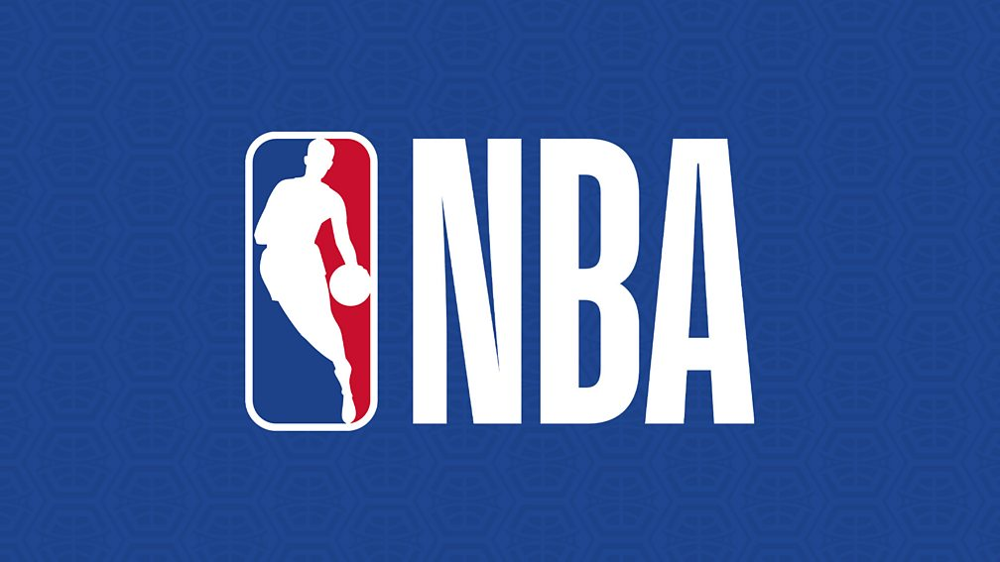

# NBA Game Outcome Prediction

This project explores whether **NBA game outcomes** can be predicted using historical team statistics.

The project was developed as the **final project for the Introduction to Pattern Recognition course** during my **Bachelor's degree in Computer Engineering at Erciyes University**.

The goal was to apply machine learning algorithms to sports analytics data and evaluate how well game results can be predicted based on statistical metrics.

---

## Project Overview

Using NBA match statistics from multiple seasons, the project attempts to predict game outcomes using a classification approach.

Each game is represented by a set of statistical features describing team performance during the match.

The model attempts to classify game results based on these features.

---

## Dataset

The dataset contains NBA game statistics from two seasons:

- 2016–2017
- 2017–2018

Files included in the repository:

- `2016-17_teamBoxScore.csv`
- `2017-18_teamBoxScore.csv`

Dataset characteristics:

- **4920 samples**
- **123 features per sample**

The features include various team performance metrics recorded during NBA games.

---

## Machine Learning Workflow

The following steps were applied in the project:

1. Data loading and preprocessing  
2. Feature selection  
3. Dataset preparation  
4. Model training  
5. Cross-validation  
6. Model evaluation  

The workflow is implemented in:

`main.ipynb`

---

## Classification Algorithms

Several machine learning algorithms were evaluated:

- Random Forest
- Support Vector Classifier (SVC)
- K-Nearest Neighbors
- Decision Tree

These models were trained and compared based on their classification performance.

---

## Performance Evaluation

The models were evaluated using the following metrics:

- Sensitivity
- Specificity
- AUC (Area Under ROC Curve)

### Metric Definitions

**Sensitivity**

Correct predictions for class 1 divided by total samples in class 1.

**Specificity**

Correct predictions for class 2 divided by total samples in class 2.

**AUC**

Area under the ROC curve.

---

## Project Structure

    IPR-Final-NBA
    ├── main.ipynb
    ├── 2016-17_teamBoxScore.csv
    ├── 2017-18_teamBoxScore.csv
    ├── IPR_final.pdf
    ├── Report[ENG].txt
    ├── Rapor[TR].txt
    ├── nbalogo.jpeg
    └── README.md

---

## Technologies Used

- Python
- Jupyter Notebook
- Pandas
- NumPy
- Scikit-learn

---

## Development Context

This project was developed as part of the **Introduction to Pattern Recognition course**.

The objective was to build a machine learning pipeline using real-world sports data and evaluate classification algorithms.

---

## Author

**Furkan Yilmaz**

Developed during my **Bachelor's degree in Computer Engineering at Erciyes University**.

Currently pursuing an **M.Sc. in Computer Science at HAW Kiel University of Applied Sciences (Germany)**.

